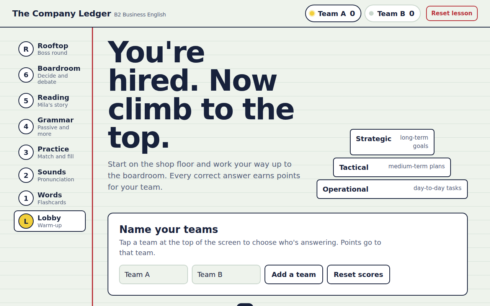

# The Company Ledger — interactive Business English lesson

**Live demo:** https://reymean.github.io/company-ledger/

I teach a weekly English lesson to a university student who studies business and economics in English as a second language. Worksheets were boring, so I used **Claude** to turn one B2 lesson on management and accounting vocabulary into a game we play on a laptop or TV.

The idea: you're a new hire at a company and "get promoted" floor by floor. The floors follow the same strategic → tactical → operational hierarchy that the vocabulary teaches.

## Floors

| Floor | Activities |
|---|---|
| Lobby | Name your teams; guess the 4 sources of raw data before revealing them |
| 1 · Words | Flip flashcards (with a "Russian first" mode); sort assets vs. liabilities |
| 2 · Sounds | Sound board with stressed syllables, tips for sounds Russian speakers find hard, stress-hunter and listen-and-choose games |
| 3 · Practice | Match terms to definitions; fill gaps in workplace sentences |
| 4 · Grammar | Passive voice, word + preposition pairs, word formation |
| 5 · Reading | A short story ("Mila's First Quarter") with tap-to-translate words and inline grammar choices |
| 6 · Boardroom | Decide which management level makes each decision; timed debate spinner |
| Rooftop | 10-question timed boss round |

Team scoring is built in: tap a team to choose who's answering, and correct answers add points with a random compliment.

## How I built it

- I started from a vocabulary list and a printable lesson, then asked Claude to rebuild it as a single self-contained HTML page.
- I used it in real lessons and asked for changes after each one: a pronunciation floor, a grammar floor, a full reset button (after a mid-lesson mix-up), and grammar choices inside the reading text at natural difficulty points.
- One file, no dependencies besides web fonts. Pronunciation uses the browser's built-in speech voice. Works on desktop and phone, light and dark mode.
